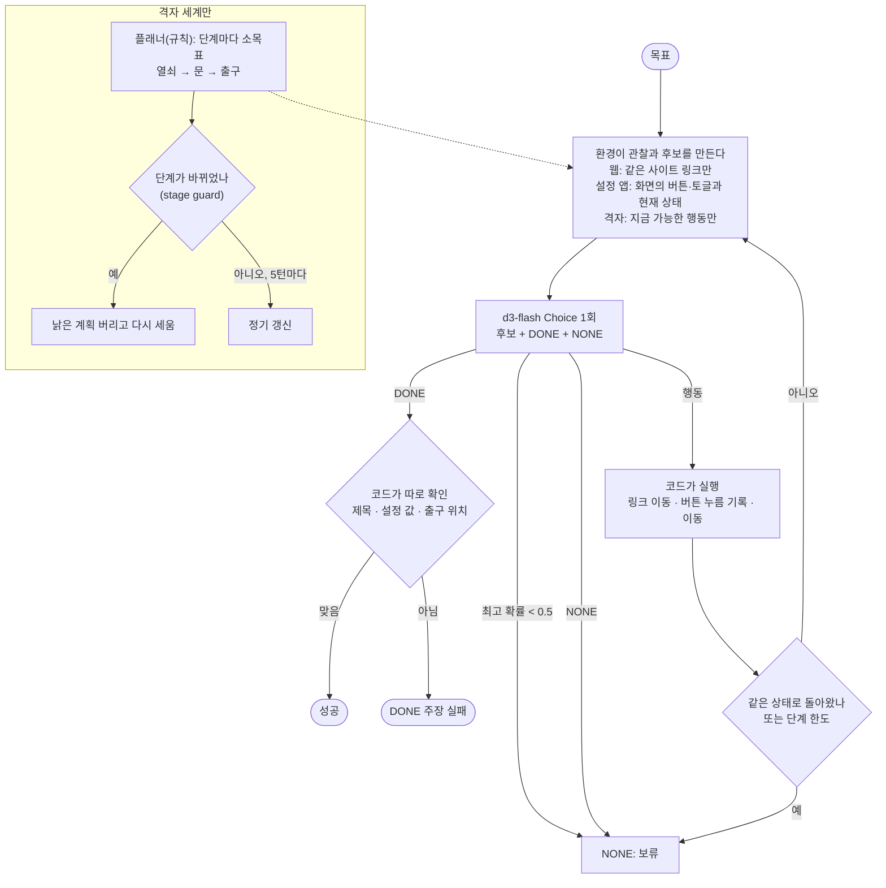

# action-picker

에이전트가 다음에 할 행동 하나를 고른다. 환경마다 지금 할 수 있는 행동만 후보로 만들고, 로컬 `d3-flash`가 그중 하나를 고른다. 후보에는 DONE(목표 도달)과 NONE(갈 곳 없음, 보류)을 함께 둔다. 같은 고르기 함수를 세 환경에서 돌린다.

1. **사내 도움말 웹사이트**(정적 HTML 15쪽): 목표 문서까지 링크를 따라간다. 외부 링크는 후보로 주지 않는다.
2. **설정 앱**(접근성 트리 모의, 요소 약 20개): 다크 모드, VPN 연결 같은 설정을 바꾼다. 실제 OS는 건드리지 않고 기록만 남긴다(dry run).
3. **텍스트 격자 세계**: 열쇠를 줍고, 문을 열고, 출구로 간다. 규칙 기반 플래너가 소목표를 정하고 d3-flash가 행동을 고르는 2계층이다.

- 참고: [jev-ultrafast](https://github.com/browser-use/jev-ultrafast)(DOM 후보 표에서 행동 선택), [Agent Desktop](https://github.com/lahfir/agent-desktop)·[typesafe-computer-use](https://github.com/awlevin/typesafe-computer-use)(접근성 트리), [minecraft-agent](https://github.com/rmalde/minecraft-agent)(System 2 플래너 + Jev 컨트롤러, stage guard)
- 이슈: #1(브라우저 다음 행동), #19(데스크톱 조작), #18(플래너 + 실시간 컨트롤러)

## 처리 흐름



- **모델은 행동 하나만 고른다.** 후보 목록, 실행, 단계 한도, 반복 감지, DONE 뒤의 확인은 모두 코드가 한다.
- **확신이 없으면 멈춘다.** 최고 확률이 0.5 미만이면 NONE이다. 아무 링크나 눌러 보는 것보다 사람에게 넘기는 쪽을 골랐다.
- **DONE을 믿지 않는다.** 모델이 DONE이라고 하면 코드가 제목, 설정 값, 출구 위치를 따로 확인한다.
- **설정 앱의 후보에는 현재 상태를 붙인다.** 실제 접근성 트리처럼 "(이미 적용됨)"을 보여 준다. 처음에는 이것이 없어서, VPN을 연결한 뒤에도 같은 버튼을 다시 눌러 반복 감지로 멈췄다.

## 격자 세계: 행동의 크기

격자 세계는 후보를 어떤 크기로 주느냐에 따라 결과가 크게 갈렸다.

| 후보 | 결과(지도 3개) |
|---|---|
| 한 칸 이동 + 목표의 직선 위치(동쪽 3칸) | **0/3**. 벽을 돌아가야 하는 곳에서 목표 쪽으로만 가다 막혔다 |
| 한 칸 이동 + 이동별 실제 걸음 수(코드가 계산) | 1/3~2/3. 실행마다 달랐다 |
| 높은 수준 행동(열쇠로 이동, 문 열기, 출구로 이동, 미끼 아이템) + 경로는 코드가 걷기 | **3/3**, 세 지도 모두 최단 경로와 같은 걸음 수 |

d3-flash는 경로 탐색기가 아니다. minecraft-agent에서도 Jev는 "어디로 가서 무엇을 할지"를 고르고, 실제 이동은 Mineflayer의 경로 탐색기가 맡는다. 이 샘플의 기본값(`hints="macro"`)도 같은 분담이다. 횃불과 상자 같은 미끼는 한 번도 고르지 않았다. 열쇠를 주웠을 때와 문을 열었을 때 stage guard가 낡은 계획을 두 번 버렸다.

## 실행

레포 루트 `.env`의 `DECISION_*`를 쓴다. LLM은 쓰지 않는다.

```bash
uv sync
uv run pytest -q                  # 오프라인, 7개
uv run python demo.py             # 웹 8 + 설정 앱 6 + 격자 3×3가지 방식, 약 20초
uv run python demo.py grid        # 격자만
```

## 측정 (d3-flash, 2026-10-20)

| 환경 | 결과 | 비고 |
|---|---|---|
| 웹(목표 8개, 그중 사이트에 없는 목표 1개) | **7/8** | 대부분 2~3번 클릭으로 도착하고 DONE. 사이트에 없는 "급여명세서 PDF"는 한 번 둘러본 뒤 NONE으로 멈췄다 |
| 설정 앱(목표 6개, 그중 없는 기능 1개) | **6/6** | VPN은 네트워크 → VPN 설정 → 연결의 3단계. "프린터 용지"는 바로 NONE |
| 격자(지도 3개, 높은 수준 행동) | **3/3** | 최단 경로 걸음 수와 같음 |

- 웹에서 실패한 1건은 "모니터 하나 더 신청하고 싶어"다. 첫 화면에서 IT 지원(0.45)과 총무·시설(0.49)이 갈려 둘 다 0.5에 못 미쳤고, 보류 규칙으로 멈췄다. 실제로 헷갈릴 만한 요청이다. 되돌아가며 둘 다 시도하는 탐색은 넣지 않았다.
- 결정 1회는 약 0.1~0.3초였다. 사이트, 설정 앱, 지도, 목표는 모두 직접 만든 작은 세트다.
