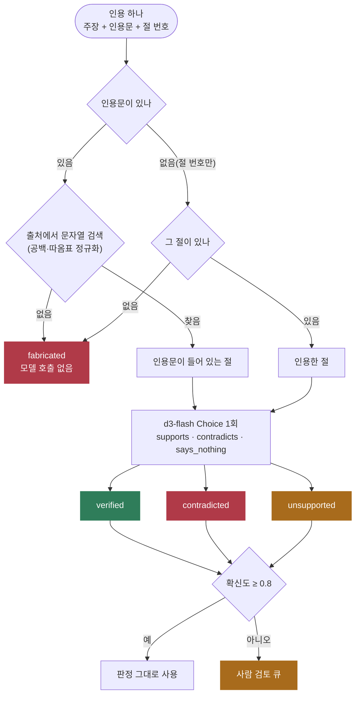

# citation-check

LLM이 답변에 붙인 인용을 출처 문서와 대조한다. 인용문이 출처에 있는지는 문자열로 확인하고, 그 인용이 들어 있는 절이 주장을 지지하는지·반박하는지·말하지 않는지는 로컬 `d3-flash`의 `Choice` 질문 하나로 판정한다. 결과는 4가지다: **verified**, **contradicted**, **unsupported**, **fabricated**. 확신도가 0.8 미만이면 사람 검토 큐로 보낸다.

- 참고: [TypeSafe cookbook: Double-checking citations](https://docs.typesafe.ai/cookbooks/citation_check)
- 이슈: #4

## 처리 흐름



- **문자열 검사가 먼저**다. 출처에 없는 인용은 모델이 판단할 필요가 없다. 숫자 하나만 바꾼 인용(`24시간` → `48시간`)도 여기서 걸린다. 줄바꿈과 둥근 따옴표는 정규화한 뒤 비교한다.
- **모델은 인용문이 실제로 있는 절을 읽는다.** 인용한 절 번호가 틀려도 인용문이 다른 절에 있으면 그 절로 판정한다. 인용문 없이 절 번호만 든 주장은 그 절을 읽는다.
- **verified는 이 출처와 주장의 관계일 뿐이다.** 출처 자체가 맞는지, 최신인지는 보장하지 않는다.
- 확신도(`confidence`)는 TypeSafe가 확률 분포의 쏠림으로 계산한 값이다. 고른 선택지의 확률과는 다르다.

## 실행

레포 루트 `.env`의 `DECISION_*`, `LOCAL_LLM_*`를 쓴다.

```bash
uv sync
uv run pytest -q                       # 오프라인, 6개
uv run python demo.py                  # 라벨 15건 + 로컬 LLM 답변 2개 검사
uv run python demo.py --no-llm         # 라벨 15건만
uv run python demo.py "퇴사자 권한은?"  # 원하는 질문으로 LLM 답변을 만들어 검사
```

`demo.py`는 로컬 LLM에게 `source.md`만 근거로 답하고 주장마다 원문 인용과 절 번호를 붙이라고 시킨 뒤(`with_structured_output`), 그 인용을 같은 방식으로 검사한다.

## 측정 (d3-flash, 2026-10-20)

`source.md`는 지어낸 사내 개인정보 처리 지침 10개 절이다. `citations.py`에 인용 15건을 직접 라벨링했다. 정확한 인용 6건, 일부러 틀린 인용 6건(출처에 없는 인용 2, 반박 2, 무관 2), 애매한 주장 3건이다.

| 결과 | 건수 |
|---|---|
| 라벨 일치 | **15/15** |
| 모델 호출 | 13건(fabricated 2건은 문자열 검사에서 끝남), 약 2초 |
| 사람 검토 큐 | 3건, 모두 애매한 주장(확신도 0.61~0.76). 판정 자체는 라벨과 같았다 |

- 예외 조항을 원칙처럼 인용한 주장("보안팀 승인 없이도 외부 클라우드 저장 가능", 인용은 "승인한 저장소에는 저장할 수 있다")은 확신도 0.97로 contradicted였다.
- 실제 인용문에 무관한 주장을 붙인 경우(팀장 승인 문장으로 MDM 의무를 주장)는 unsupported였다.
- "비밀번호는 안전하게 보관된다"처럼 막연한 주장은 supports 0.89였지만 확신도 0.67로 사람에게 갔다.
- 로컬 LLM(muse-glimmer-30b)이 쓴 답변 2개의 인용 6건은 모두 출처에 있었고 모두 verified였다. 이 문서가 짧아 LLM이 문장을 그대로 옮기기 쉬웠다. 긴 문서에서는 fabricated가 더 나올 수 있다.
- 라벨과 문서를 직접 만들었으므로 15/15는 이 세트에서의 결과다. 처음 보는 문서의 정확도로 읽지 않는다.
