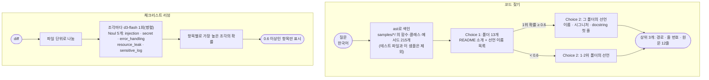

# code-judge

코드에 대한 판정 두 가지를 담았다.

1. **동작으로 코드 찾기**: "비밀값을 가려서 보내는 곳은?" 같은 질문으로 이 레포의 샘플 코드에서 함수를 찾는다. 낱말 대신 동작으로 찾는다. 폴더를 먼저 고르고, 그 안의 선언(함수·클래스·메서드)을 고른다.
2. **체크리스트 리뷰**: diff를 파일 단위로 나눠 정해진 질문 5개(주입, 비밀 하드코딩, 오류 삼킴, 자원 누수, 민감 정보 로그)를 판정한다. 리뷰 문장 대신 체크리스트 결과만 낸다.

판정은 로컬 `d3-flash`가 한다. 찾은 코드를 읽고 고치는 일, 리뷰 결과로 무엇을 할지는 사람이나 호출한 에이전트가 정한다.

- 참고: [jevgrep](https://github.com/dzhng/jevgrep)(계층 탐색 코드 검색), [jev-review](https://github.com/devagrawal09/jev-review)(기준별 판정 리뷰)
- 이슈: #12(동작 기반 코드 검색), #13(단계형 코드 리뷰)

## 처리 흐름



- **폴더 설명에 선언 이름을 넣는다.** README 소개만 줬을 때는 20문항 중 9문항에서 폴더를 잘못 골랐다(top-1 11/20). 선언 이름 목록을 붙이니 17/20이 됐다.
- **선택지가 255개 안이면 한 번에 물을 수도 있다.** 선언 215개를 Choice 하나로 묻는 방식(flat)도 함께 쟀다. 정확도는 비슷하고 시간은 3배 걸렸다.
- **리뷰 질문은 "추가된 코드"만 본다.** 문제를 없애는 변경(문자열 SQL → 매개변수 SQL)은 깨끗한 변경이다.

## 실행

레포 루트 `.env`의 `DECISION_*`를 쓴다. LLM은 쓰지 않는다.

```bash
uv sync
uv run pytest -q            # 오프라인, 5개
uv run python demo.py       # 질문 20개(세 방식) + diff 12개, 약 1분 30초
uv run python demo.py review
```

## 측정 (d3-flash, 2026-10-20)

### 코드 찾기: 질문 20개

`questions.py`의 질문은 이 레포 샘플의 실제 함수를 정답으로 삼았다(정답이 둘인 질문 3개 포함). 질문은 한국어, 코드는 영어다.

| 방식 | top-1 | top-3 | 질문당 |
|---|---|---|---|
| **2단계(폴더 → 선언)** | **17/20** | 19/20 | 1.2초 |
| 한 번에(선언 215개 Choice) | 16/20 | **20/20** | 3.8초 |
| 키워드 BM25(선언 원문) | 2/20 | 6/20 | — |

- 2단계가 틀린 3건 중 2건은 같은 클래스를 골랐다. 메서드 `ImageClassifier._payload` 대신 클래스 `ImageClassifier`, 함수 `gate` 대신 같은 파일의 `MemoryGateMiddleware`다. 나머지 1건("답이 비었거나 잘렸는지")은 다른 샘플의 비슷한 미들웨어로 갔다.
- 키워드 검색은 질문(한국어)과 코드(영어)의 낱말이 거의 겹치지 않아 대부분 놓쳤다. jevgrep이 동작 기반 검색을 내세우는 이유다.
- 색인은 실행할 때 `ast`로 다시 만든다. 샘플이 늘면 결과가 바뀔 수 있다.

### 체크리스트 리뷰: diff 12개

`diffs.py`에 결함을 심은 diff 7개(결함 8개)와 깨끗한 diff 5개를 만들었다.

| 항목 | 결과 |
|---|---|
| 심은 결함 탐지 | **8/8** |
| 잘못 표시 | 2건(깨끗한 확인 52개 중) |
| 시간 | 12개 × 질문 5개, 약 7.7초 |

- 잘못 표시 2건: API 키를 소스에 박은 diff에 "오류 삼킴"도 붙였다. 토큰을 출력하고 예외를 삼키는 diff에 "자원 누수"도 붙였다(`requests.get`을 닫지 않는다고 봤다).
- 깨끗한 diff 5개(결함을 고치는 변경 4개, 이름만 바꾼 변경 1개)는 하나도 표시하지 않았다.
- diff와 질문은 직접 만들었다. 실제 PR에서의 탐지율이 아니다.
