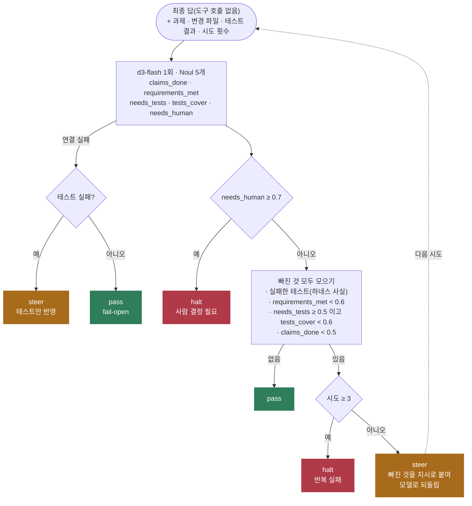

# completion-check

코딩 에이전트가 "다 했다"고 할 때 정말 끝났는지 판정한다. 결과는 세 가지다.

- **pass**: 그대로 받는다.
- **steer**: 무엇이 빠졌는지 지시를 붙여 돌려보낸다.
- **halt**: 멈추고 사람을 부른다. 에이전트가 결정이나 권한을 요청했거나, 같은 일을 계속 실패하는 경우다.

테스트 실패나 시도 횟수처럼 하네스가 이미 아는 사실은 코드가 정한다. 완료 주장, 요구사항 충족, 테스트 충분성, 사람 개입 필요는 로컬 `d3-flash`가 판정한다. LangChain 에이전트에는 `after_model` 미들웨어로 붙여, 최종 답이 나올 때마다 검사하고 steer면 모델로 되돌린다.

- 참고: [Foreman](https://github.com/thruwire/foreman), [Hermes hooks의 `pre_verify`](https://hermes-agent.nousresearch.com/docs/user-guide/features/hooks)
- 이슈: #10(코딩 에이전트 감독자), #37(pre_verify 훅에서 완료 판정)

## 처리 흐름



- **사람을 찾는 답이 먼저**다. "어느 계정을 남길지 정해 주셔야 합니다"처럼 결정·권한·정보를 요청하면 다른 판정과 상관없이 멈춘다.
- **steer는 빠진 것을 한 번에 다 알려 준다.** 실패한 테스트, 빠진 요구사항, 부족한 테스트를 모두 지시에 넣는다. 지시문은 LLM이 아니라 코드가 만든다.
- **테스트가 필요한 과제인지도 묻는다.** 처음에는 "테스트가 필요 없으면 yes라고 답하라"를 한 질문에 넣었더니 README 수정 과제 2건을 테스트 부족으로 돌려보냈다. 질문을 `needs_tests`와 `tests_cover` 둘로 나누고, 코드가 둘을 묶었다.
- **요구사항은 답에 적힌 것만 인정한다.** "page·size 추가, 테스트 통과, 완료"처럼 상한과 total을 말하지 않은 답을 d3-flash가 0.96으로 통과시켰다. 질문을 "답에 언급하지 않은 요구사항은 안 한 것으로 본다"로 바꾸니 0.38로 내려갔다.
- **시도 상한은 3회**다. 대화 안의 steer 메시지 수로 세므로 상태를 따로 두지 않는다.
- **판정 서버가 죽으면 통과(fail-open)**다. 감독자가 고장 나 에이전트를 무한 루프에 가두지 않게 하려는 것이다. 다만 테스트 실패는 서버 없이도 아는 사실이라 steer한다.

## 실행

레포 루트 `.env`의 `DECISION_*`, `LOCAL_LLM_*`를 쓴다.

```bash
uv sync
uv run pytest -q                 # 오프라인, 14개
uv run python demo.py            # 30건 측정 + 에이전트 2회(정상 / 첫 답을 일부러 덜 쓴 경우)
uv run python demo.py --eval-only
```

라이브 데모의 에이전트는 로컬 LLM으로 릴리스 노트를 쓴다(요구 3가지: 세 변경 포함, 이슈 번호, 업그레이드 주의 절). 두 번째 실행은 첫 답만 미리 써 둔 덜 된 초안으로 바꿔, steer가 실제로 어떻게 돌아가는지 보여 준다.

## 측정 (d3-flash + muse-glimmer-30b, 2026-10-20)

`transcripts.py`에 코딩 에이전트의 턴 끝 상태 30건(pass 10, steer 14, halt 6)을 만들고 라벨을 붙였다. 과제 6종(함수 추가, 페이지네이션, 버그 수정, README, 이름 변경, CSV 필터)이다.

| 항목 | 결과 |
|---|---|
| 라벨 일치 | **29/30**, 30건에 약 22초 |
| "완료"라고 했지만 끝나지 않은 11건 중 통과시킨 것 | 1건 |
| 틀린 1건 | "모든 사용처를 바꿨다고 생각합니다. 아마 완료일 것입니다."(이름 변경, 테스트 미실행). 이름 변경을 테스트가 필요한 변경으로 보지 않았고(0.34), 요구사항 충족도 0.72로 봤다 |

라이브 실행 2회:

| 실행 | 판정 | 결과 |
|---|---|---|
| 정상 | 1회차 pass | 세 변경, 이슈 번호, 업그레이드 주의 절 모두 포함 |
| 덜 된 첫 답(두 항목, 이슈 번호 없음) | 1회차 steer → 2회차 pass | 지시를 받은 로컬 LLM이 #52와 이슈 번호, 업그레이드 주의 절을 채웠다 |

- 질문 문구를 이 30건으로 두 번 고쳤다(첫 판 26/30). 29/30은 이 세트의 결과이고 처음 보는 트랜스크립트의 정확도가 아니다.
- 실제 코드 변경과 테스트 실행은 하지 않는다. 변경 파일과 테스트 결과는 하네스가 넘겨준다고 가정하고(`observe`), 트랜스크립트에 적어 두었다.
