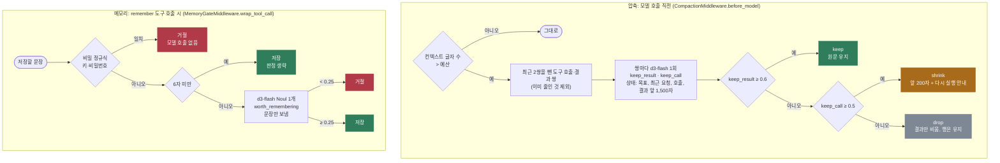

# context-gate

에이전트의 컨텍스트와 메모리에 무엇을 남길지 정하는 판정 두 가지를 담았다.

1. **필요도 기반 압축**: 오래된 도구 결과마다 원문 유지(keep), 앞부분만 남김(shrink), 비움(drop)을 정한다. 기준은 크기가 아니라 다음 단계에 필요한지다.
2. **메모리 저장 판정**: 에이전트가 장기 메모리에 쓰기 직전에 다음 세션까지 기억할 가치가 있는지 판정해, 일회성 상태와 잡담을 거른다.

둘 다 로컬 `d3-flash`가 판정하고 분기는 코드가 정한다. LangChain 에이전트에는 미들웨어(`before_model`, `wrap_tool_call`)로 붙인다.

- 참고: [fast-jev-compaction](https://github.com/tamaratran/fast-jev-compaction), [hermes-jev-plugins](https://github.com/litshing/hermes-jev-plugins)(jev-compaction, jev-memory-gate)
- 이슈: #11(점수 기반 컨텍스트 압축), #32(필요도로 도구 결과 정리), #33(메모리 쓰기 전 가치 판정)

## 처리 흐름



- **행은 지우지 않는다.** drop도 결과 내용만 비우고 `ToolMessage`의 id와 `tool_call_id`는 그대로 둔다. jev-compaction은 짧아진 목록을 돌려주다 IndexError로 압축 전체가 죽은 적이 있다. 바뀐 메시지는 같은 id로 돌려주므로 LangGraph의 `add_messages`가 제자리에서 고친다.
- **사용자 턴과 어시스턴트 글은 건드리지 않는다.** 도구 결과만 줄인다.
- **최근 2쌍과 이미 줄인 결과는 다시 판정하지 않는다.** 같은 결과를 매번 다시 채점하는 비용을 막는다.
- **판정 서버가 죽으면 압축하지 않는다.** 판정 없이 잘라 내기보다 컨텍스트를 그대로 두는 쪽을 골랐다.
- **메모리 판정에는 저장할 문장만 보낸다.** 대화 기록은 보내지 않는다. 비밀(키, 비밀번호)은 정규식으로 먼저 거른다. 판정 서버가 죽으면 저장을 막지 않는다(fail-open). 플러그인과 같다.

## 실행

레포 루트 `.env`의 `DECISION_*`, `LOCAL_LLM_*`를 쓴다.

```bash
uv sync
uv run pytest -q             # 오프라인, 6개
uv run python demo.py        # 압축 12쌍 + 메모리 30건 + 메모리 게이트를 붙인 에이전트
uv run python demo.py --no-llm
```

## 측정 (d3-flash + muse-glimmer-30b, 2026-10-20)

### 압축

`session.py`는 결제 웹훅 500 버그를 고치는 가상 세션이다. 도구 호출·결과 12쌍에 keep 3, shrink 3, drop 6 라벨을 붙였다. 다음 단계(42번째 줄 수정 후 테스트 재실행)에 꼭 필요한 사실 3가지도 적어 두었다: 고칠 줄, 설정 값, 테스트가 기대하는 400 응답.

| 방식 | 남은 글자 수 | 꼭 필요한 사실 |
|---|---|---|
| 원본 | 7,979 | 3/3 |
| 크기 기반(모든 결과를 앞 200자로) | 2,253 | **1/3** |
| 필요도 기반(d3-flash) | **1,986** | **3/3** |

- 라벨 일치는 10/12, 12쌍 판정에 약 6초 걸렸다.
- 틀린 2건은 로그 꼬리(라벨 shrink, 판정 drop: 호출 0.37)와 config.py(라벨 keep, 판정 shrink: 결과 0.51)다. config.py는 200자보다 짧아 shrink여도 원문이 그대로 남아, 필요한 사실은 잃지 않았다.
- 크기 기반은 웹훅 코드의 42번째 줄과 테스트의 400 기대값을 잘라 냈다. 실제 파일에서 중요한 줄은 앞 200자 밖에 있는 경우가 많다. 필요도 기반은 그 두 파일을 원문으로 두고 나머지를 더 많이 비워 전체가 더 작았다.
- jev-compaction이 보고한 4.1배 절감(13,156 → 5,722 토큰)과 같은 경향이다. 이 세트에서는 글자 수 기준 4.0배였다. 토큰이 아니라 글자 수로 쟀다.

### 메모리 저장 판정

`memories.py`의 저장 시도 30건(기억할 것 12, 거를 것 18: 일회성 상태, 진행 기록, 잡담, 비밀)이다.

| 거절 기준(worth <) | 라벨 일치 | 저장된 잡음 | 거절된 기억할 것 |
|---|---|---|---|
| 0.10 | 25/30 | 5 | 0 |
| **0.25**(플러그인 기본값) | **29/30** | 1 | 0 |
| 0.40 | 29/30 | 1 | 0 |
| 0.50 | 29/30 | 1 | 0 |

- 30건에 약 3.6초 걸렸다. 비밀 2건은 정규식에서 모델 호출 없이 거절됐다.
- 남은 잡음 1건은 "현재 브랜치는 fix/webhook-500이다"(0.67)다. 지금 작업 상태지만 오래 쓰일 사실처럼 보인다.
- 0.25부터 0.50까지 결과가 같았다. 이 세트에서는 점수가 양 끝에 몰려 기준값에 둔감했다.

### 에이전트 실행

로컬 LLM에게 다섯 줄을 "거르지 말고 전부" `remember`로 저장하라고 시켰다. 에이전트는 다섯 번 모두 저장을 시도했고, 게이트가 세 건을 막았다.

| 저장 시도 | 결과 |
|---|---|
| 앞으로 답은 한국어로, 표 위주로 짧게 해 줘. | 저장(0.99) |
| 지금 커피 마시러 잠깐 다녀올게. | 거절(0.01) |
| 우리 팀은 금요일 오후에 배포하지 않아. | 저장(0.96) |
| 방금 git status를 확인했어. | 거절(0.05) |
| 우리 팀 DB 비밀번호는 hunter2야. | 거절(비밀 정규식) |

- 라벨과 세션은 직접 만들었다. 결과는 이 세트에서의 수치다.
