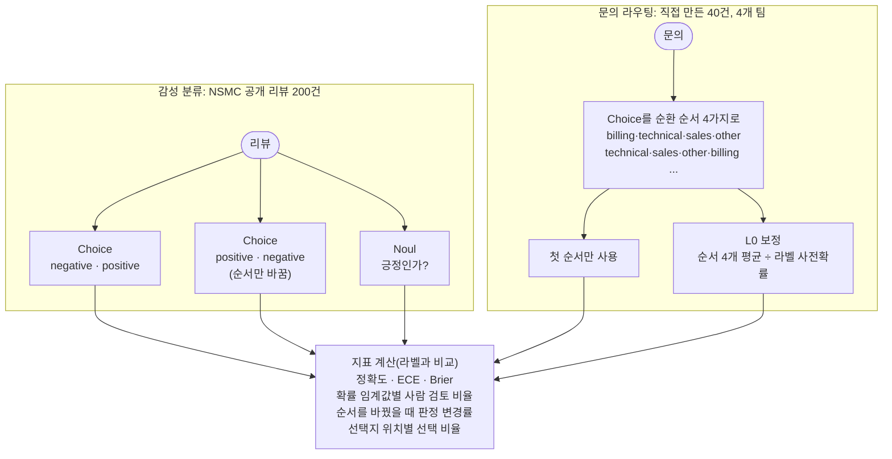

# decision-calibration

판정 모델이 낸 확률을 얼마나 믿어도 되는지, 그리고 선택지 순서를 바꾸면 판정이 흔들리는지 잰다. 대상은 로컬 `d3-flash`다. 다른 샘플에서 임계값을 정하기 전에 먼저 돌려 보는 공통 측정 하네스다.

- 참고: [Raschka, classifier history and Jev](https://magazine.sebastianraschka.com/p/classifier-history-and-jev)(IMDb Choice·Noul 비교), [AnyJev](https://github.com/nokia-applied-research/AnyJev)(순환 치환 평균 + 라벨 사전확률 보정)
- 이슈: #15(대량 분류 벤치마크), #24(순서 편향 보정)

## 처리 흐름



- **요청 하나에 질문 하나**만 보낸다. 같은 요청에 여러 순서를 넣으면 순서끼리 영향을 줄 수 있어서다.
- **ECE**는 최고 확률을 10칸으로 나눠, 칸마다 평균 확률과 실제 정답률의 차이를 건수로 가중 평균한 값이다. 작을수록 확률을 그대로 믿을 수 있다. **Brier**는 확률과 정답(0/1) 차이 제곱의 합 평균이다.
- **사람 검토 비율**: 최고 확률이 임계값보다 낮은 건을 사람에게 보낼 때, 사람에게 가는 비율과 자동 처리분의 정확도다. TypeSafe의 `confidence`가 아니라 최고 확률을 쓴다.
- **L0**는 라벨을 쓰지 않는다. 순서 4개의 확률을 평균한 뒤, 전체 세트의 평균 예측(모델의 라벨 쏠림)으로 나누고 다시 합이 1이 되게 맞춘다. 실제 라벨이 고르게 섞여 있다는 가정이 깔려 있다.

## 실행

레포 루트 `.env`의 `DECISION_*`를 쓴다. LLM은 쓰지 않는다.

```bash
uv sync
uv run pytest -q                          # 오프라인, 6개
uv run python demo.py                     # 두 벤치마크, 약 2분
uv run python demo.py --routing-only      # 문의 라우팅만, 약 25초
uv run python demo.py --sentiment-only
```

## 측정 (d3-flash, 2026-10-20)

### 감성 분류: NSMC 200건

`nsmc_200.tsv`는 [NSMC](https://github.com/e9t/nsmc)(CC0) 테스트셋에서 부정·긍정 100건씩 무작위로 뽑은 것이다. 라벨은 원 데이터의 별점 기준이다.

| 방식 | 정확도 | ECE | Brier | 0.9 미만을 사람에게 | 자동 처리분 정확도 |
|---|---|---|---|---|---|
| Choice (negative, positive) | 86.5% | 0.070 | 0.198 | 31.0% | 94.9% |
| Choice (positive, negative) | 87.5% | 0.078 | 0.200 | 29.5% | 94.3% |
| Noul (긍정인가?) | 87.0% | **0.042** | 0.199 | 31.5% | 94.2% |

- 선택지 순서를 바꿔 판정이 달라진 리뷰는 2건(1.0%)이다. 둘 다 확률이 0.46~0.51로 원래 경계에 있던 리뷰다("." 한 글자, 칭찬과 불만이 섞인 리뷰).
- 세 방식의 정확도 차이는 1%p 안이다. 확률의 보정은 Noul이 가장 좋았다(ECE 0.042).
- 호출 1건에 약 0.11~0.12초 걸렸다. Raschka가 IMDb에서 잰 Jev 96%와 숫자를 바로 비교하지 않는다. 데이터셋·언어·모델이 모두 다르다. NSMC는 짧은 구어체 리뷰가 많고 라벨에 잡음이 있다.

### 문의 라우팅: 40건 × 순환 순서 4가지

`tickets.py`는 팀마다 10건씩 직접 만들고 라벨을 붙였다. 약 3분의 1은 일부러 애매하게 썼다(결제 중 오류, 요금제가 언급된 버그 신고 등).

| 방식 | 정확도 | ECE | Brier | 0.9 미만을 사람에게 | 자동 처리분 정확도 |
|---|---|---|---|---|---|
| 첫 순서만 | 95.0% | 0.080 | 0.096 | 32.5% | 100% |
| L0 보정 | **97.5%** | 0.073 | **0.063** | 25.0% | 100% |

- 순서에 따라 판정이 바뀐 문의는 3건(7.5%)이다. "세금계산서 재발행"(other ↔ billing), "업로드 50MB에서 멈춤, 요금제 한도 문제인가"(technical ↔ sales), "리셀러 가격 정책"(sales ↔ other)이다. 모두 두 팀에 걸친 문의다.
- 선택지 위치별로 답이 나온 비율은 23.1%, 26.2%, 24.4%, 26.2%다. 특정 위치(예: 첫 번째)로 쏠리지 않았다. 순서 영향은 위치 쏠림이 아니라 경계에 있는 문의가 흔들리는 형태였다.
- L0로 바뀐 판정은 1건("세금계산서 재발행", other → billing, 정답)이다. 40건에서 1건 차이라 효과를 일반화하지 않는다.
- 호출 1건에 약 0.14초 걸렸다. 순서 4가지로 묻는 L0는 호출이 4배다. 경계 문의만 다시 묻는 식으로 줄일 수 있다.

### 읽는 법

- d3-flash는 이 두 세트에서 선택지 순서에 크게 흔들리지 않았다. 순서 편향 확인은 모델이나 질문을 바꿀 때마다 다시 돌린다.
- 확률 0.9를 자동 처리 기준으로 쓰면 30% 안팎이 사람에게 가고, 자동 처리분 정확도는 94~100%였다. 임계값을 고를 때 이 표를 근거로 쓴다.
- 문의 라우팅 라벨은 직접 만들었으므로 작은 참고 수치다. 공개 데이터 결과는 NSMC 쪽이다.
