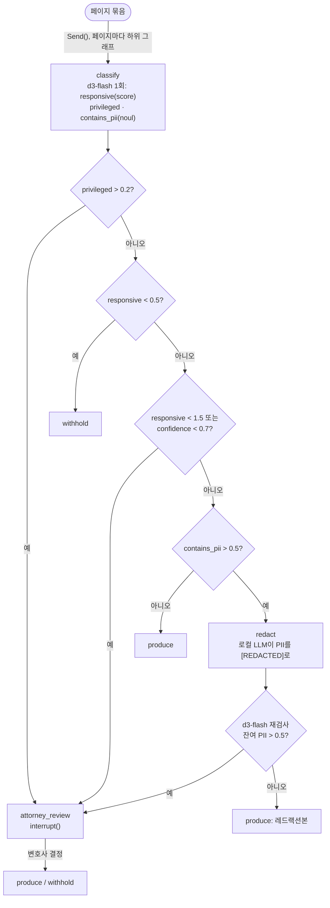
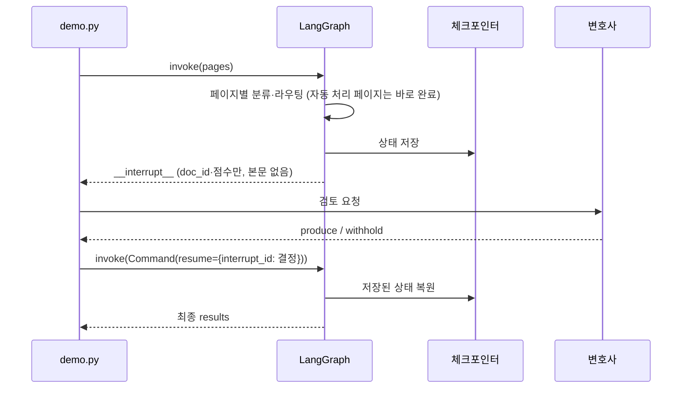

# 디스커버리 문서 검토 — LangGraph + d3-flash

소송 디스커버리(e-discovery)의 페이지 단위 검토 파이프라인이다. 각 페이지를 검토 기준에 대해 한 번 분류하고, 일반 Python 코드가 결과를 네 처리(제출·보류·레드랙션·변호사 검토) 중 하나로 보낸다.

분류기는 LLM이 아니라 결정 모델이다. 로컬 `d3-flash`가 질문마다 확률을 돌려주므로 라우팅에 파싱 단계가 없다. 생성 모델(로컬 LLM)은 레드랙션이 필요한 페이지에만 쓴다.

참고: [Building prod with Jev and LangGraph](https://www.langchain.com/blog/building-prod-with-jev-and-langgraph), [원본 예제 gist](https://gist.github.com/sydney-runkle/a632ba4ea0b2b72501dfa4b6ab2a7d8a). 원본의 Jev·SemIf·Claude를 로컬 모델로 바꿨다.

### 페이지 라우팅



특권 문서를 내보내는 비용이 가장 크므로 특권 판정을 가장 먼저, 낮은 임계값(0.2)으로 본다. 관련성은 점수가 기댓값이라 구간으로 읽고, 애매한 중간 구간은 사람에게 넘긴다.

### 변호사 검토 중단과 재개



- `Send()`로 페이지마다 하위 그래프를 하나씩 띄워 동시에 분류한다.
- `attorney_review`는 `interrupt()`로 멈추고, 변호사 결정을 `Command(resume=...)`으로 받아 이어 간다. 체크포인터가 그 사이의 상태를 보존한다.
- 원본과 다른 점: 레드랙션 결과를 d3-flash로 다시 검사한다. PII가 남았다고 판정하면 제출하지 않고 변호사 검토로 보낸다.

## 파일

| 파일 | 내용 |
|---|---|
| `review.py` | 그래프와 검토 정책(질문·임계값). `build_review_graph(classifier, redaction_model, checkpointer)` |
| `corpus.py` | 가상 페이지 6개(사건·이름·계좌번호 모두 허구) |
| `demo.py` | 로컬 모델로 코퍼스를 한 번 처리하고 집계를 출력한다 |
| `test_review.py` | 오프라인 테스트 15개: 모든 분기, 재개, 잔여 PII, `MockTransport`로 실제 클라이언트 연결 |

## 실행

레포 루트 `.env`의 값을 쓴다.

| 변수 | 용도 |
|---|---|
| `DECISION_BASE_URL` / `DECISION_MODEL` / `DECISION_API_KEY` | d3-flash. `langchain-typesafe`의 `TypeSafeClassifier`를 `base_url`만 바꿔 쓴다 |
| `LOCAL_LLM_URL` / `LOCAL_LLM_MODEL` | 레드랙션용 OpenAI 호환 LLM. 사고(thinking)는 끈다 |

```bash
cd samples/discovery-review
uv sync
uv run pytest            # 네트워크 없이 실행된다
uv run python demo.py    # 변호사 결정은 스크립트 값을 쓴다
uv run python demo.py --ask   # 변호사 결정을 터미널에서 입력한다
```

## 실측 (2026-10-19, d3-flash + muse-glimmer-30b)

| doc_id | 기대 | 결과 | d3-flash 근거 |
|---|---|---|---|
| ARC-000141 | produce | produce | |
| ARC-000212 | withhold | withhold | |
| ARC-000377 | redact | produce(레드랙션) | 레드랙션 후 재검사 통과 |
| ARC-000401 | attorney_review | 변호사 검토 | privileged 0.99 |
| ARC-000455 | attorney_review | 변호사 검토 | responsive 0.98(중간 구간), confidence 0.13 |
| ARC-000508 | produce | 변호사 검토 | responsive 1.77, confidence 0.49 < 0.7 |

6페이지 전체(분류 + 레드랙션 + 재검사)가 4–5초 걸렸다. 임계값은 원본 그대로다. ARC-000508은 점수로는 분명히 관련 문서지만, 확률이 두 단계에 나뉘어 confidence가 낮다. 원본 데모도 이 페이지를 변호사 검토로 보낸다. 특권 문서를 제출하는 비용이 더 크므로 보수적인 현재 값을 유지했다.

## 알아 둘 점

- `Score.score`는 단계 번호가 아니라 기댓값이다. `score == 0` 대신 구간으로 판정한다.
- confidence는 정답 여부가 아니라 분포의 집중도다. 모델마다 정의가 달라 다른 엔진의 임계값을 그대로 가져오면 안 된다. 모델을 바꾸면 다시 맞춘다.
- `interrupt()` 값은 체크포인트에 저장된다. 그래서 변호사에게는 문서 ID와 점수만 보내고 본문은 보내지 않는다.
- 체크포인터는 `ClassifierResponse`만 역직렬화하도록 허용 목록을 둔다. LangGraph의 기본 permissive 모드는 임의 클래스를 복원하며 경고를 낸다.
- d3-flash 서버는 요청의 `model` 값을 무시한다. 인증이 꺼져 있으면 Bearer 키도 확인하지 않는다.
- `langchain-typesafe`는 알파(`0.0.1a3`)라 API가 바뀔 수 있다. 버전을 고정했다.
