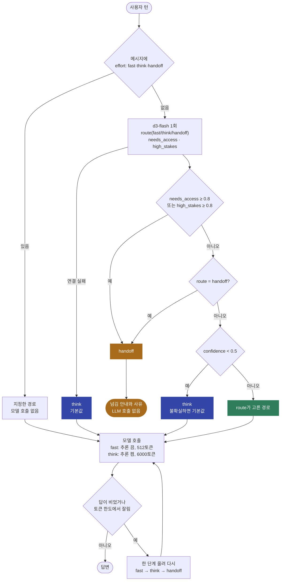

# effort-router

사용자 턴마다 그 턴에 모델을 얼마나 쓸지 정한다. 로컬 LLM 하나를 세 경로로 나눠 쓴다.

- **fast**: 추론을 끄고 짧은 예산으로 답한다. 사실 한 줄, 잡담, 짧은 문장 고치기.
- **think**: 추론(`enable_thinking`)을 켠다. 계산, 세기, 퍼즐처럼 빨리 답하면 틀리기 쉬운 턴.
- **handoff**: 여기서 답하지 않고 사람이나 상위 시스템으로 넘긴다. 실시간·사내 데이터, 실제 행동(송금, 삭제), 법률·의료·금전 결정.

판정은 로컬 `d3-flash`가 턴마다 한 번 하고, 분기는 일반 코드가 정한다. LangChain 에이전트에는 미들웨어(`before_agent` + `wrap_model_call`)로 붙인다.

- 참고: langchain-typesafe `ModelRouterMiddleware`, [Hermes jev-effort-router](https://hermes-agent.nousresearch.com/docs/plugins/jev-effort-router), [effortless-hermes](https://hermes-agent.nousresearch.com/docs/plugins/effortless-hermes), [Intern-Decision](https://arxiv.org/abs/2610.22131)
- 이슈: #7(모델 라우팅 미들웨어), #21(신뢰도 기반 상위 모델 이관), #29(턴별 모델·추론 강도), #30(턴별 effort 판정과 실패 시 상향)

## 처리 흐름



- **안전 조건이 먼저**다. 실시간·사내 데이터나 실제 행동이 필요하거나, 틀리면 법률·의료·금전 피해가 나는 턴은 route 판정과 상관없이 넘긴다.
- **불확실하면 think**다. 확신도(`confidence`)가 0.5 미만이면 기본값인 think로 간다. jev-effort-router가 확신도가 낮을 때 기본 모델을 유지하는 것과 같은 방식이다. 판정 서버에 연결하지 못해도 think다.
- **답이 비었거나 잘리면 한 단계 올린다.** fast 답이 512토큰 한도에서 끊기면 같은 턴 안에서 think로 다시 답한다. effortless-hermes는 다음 턴의 effort를 올리지만, 이 샘플은 그 자리에서 다시 시도한다.
- 메시지에 `effort: think`처럼 적으면 판정을 건너뛴다.
- langchain-typesafe의 `ModelRouterMiddleware`도 같은 자리에서 모델을 고른다. 다만 판정기를 환경 변수로 직접 만들어 로컬 d3-flash를 주입할 수 없고, 임계값·폴백·이관이 없다. 그래서 같은 구조(`before_agent`에서 판정 → `wrap_model_call`에서 모델 교체)로 다시 만들었다.
- 상위 모델이 로컬에 없어서 handoff는 넘김 안내만 돌려준다. 내부 대형 모델이 생기면 `models`에 경로를 하나 더 두고 `LADDER`를 늘리면 된다.

## 실행

레포 루트 `.env`의 `DECISION_*`, `LOCAL_LLM_*`를 쓴다.

```bash
uv sync
uv run pytest -q                      # 오프라인, 18개
uv run python demo.py                 # 32턴 라우팅 + 정답 있는 23턴 비교, 약 5분
uv run python demo.py --route-only    # 라우팅만, 약 12초
uv run python demo.py "2의 50제곱의 마지막 자리 숫자는?"
```

## 측정 (d3-flash + muse-glimmer-30b, 2026-10-20)

`turns.py`의 턴 32개(fast 10, think 16, handoff 6)에 직접 라벨을 붙였다. think 턴은 추론 없이 답하면 로컬 LLM이 틀린 적이 있는 문제(할인 함정, 회문 세기, 저울 퍼즐 등)를 골랐다.

| 항목 | 결과 |
|---|---|
| 경로 판정 | **32/32** 라벨 일치, 32턴에 약 12초 |
| 그중 확신도 폴백으로 맞은 턴 | 3건(strawberry의 r 세기, 벽 칠하기, 회문 세기). route만 보면 strawberry는 fast(0.64)였다 |
| handoff 6건 | 모두 안전 조건에서 넘어갔다(외부 데이터·행동 4, 피해 2). route 판정도 6건 모두 handoff였다 |

정답이 하나인 23턴에서 세 방식을 비교했다(순서대로 실행, 온도 0).

| 방식 | 정답 | 출력 토큰 | 시간 |
|---|---|---|---|
| 항상 fast | 21/23 | 1,683 | 44.7초 |
| 항상 think | 23/23 | 4,738 | 123.9초 |
| 라우팅 | **23/23** | 4,036 | 105.6초 |

- 라우팅은 항상 think와 같은 정답 수를 내면서 토큰과 시간을 약 15% 줄였다. 이 세트는 일부러 어려운 턴이 많다(23턴 중 16턴). 쉬운 턴 비율이 높은 실제 대화에서는 차이가 더 커진다.
- 항상 fast가 틀린 2건은 회문 세기와 저울 퍼즐이다. 할인 함정은 이번 실행에서는 맞았다. 온도 0이어도 추론 없는 답은 실행마다 흔들렸다.
- handoff 6턴은 LLM을 부르지 않는다. 송금 요청을 웹 화면에서 비교해 보니 항상 fast·항상 think도 "직접 처리할 수 없다"고 스스로 거절했다. 이관의 이득은 답의 품질보다, 사람이나 권한 있는 시스템으로 넘길 사유를 코드가 남긴다는 데 있다. 이 6턴은 위 표에 넣지 않았다.
- 라벨과 임계값(0.5 폴백)을 같은 32턴으로 정했다. 32/32는 이 세트의 결과이고 처음 보는 대화의 정확도가 아니다.
- 정답 판정은 마지막 `정답:` 줄(없으면 마지막 줄)에서 값이 따로 떨어져 나오는지 본다. `400원`에서 `0`을, `15/12`에서 `5/12`를 정답으로 세지 않는다.
