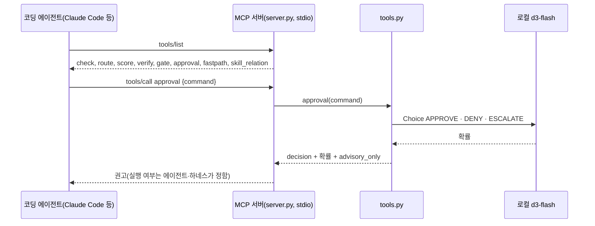
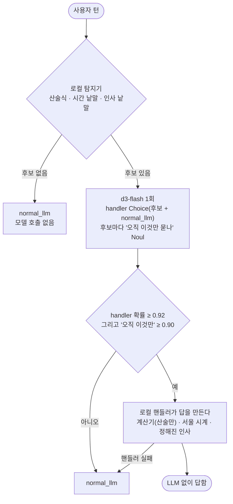

# judgment-tools

판정 모델이 하는 판단을 MCP 도구 8개로 묶어, 코딩 에이전트가 필요할 때 직접 부를 수 있게 한다. 백엔드는 `.env`가 가리키는 `/v1/systemone` 서버(여기서는 로컬 `d3-flash`)라서 판정에 쓰는 텍스트가 밖으로 나가지 않는다. 모든 결과는 권고다(`advisory_only: true`, `execution_authorized: false`). 실제로 막거나 실행하는 것은 호출한 쪽이 한다.

| 도구 | 판단 | 실패하거나 불확실할 때 |
|---|---|---|
| `check` | Noul: 예/아니오 확률 | 예외를 그대로 알림 |
| `route` | Choice: 선택지 중 하나(255개까지) | 예외를 그대로 알림 |
| `score` | Score: 순서형 기준 | 예외를 그대로 알림 |
| `verify` | 근거가 주장을 지지·반박·무관 → pass·block·review | review |
| `gate` | 제안된 행동 → pass·review·block | review |
| `approval` | 셸 명령 → APPROVE·DENY·ESCALATE | ESCALATE(확신 없는 APPROVE도 ESCALATE) |
| `fastpath` | 계산·시계·인사 턴을 LLM 없이 로컬 핸들러로 답할지 | normal_llm |
| `skill_relation` | 스킬 두 개의 관계(8가지)와 병합 힌트 | 병합하지 않음 |

- 참고: [jev-mcp](https://github.com/jkudish/jev-mcp)(판단 도구 12개를 MCP로), Hermes [jev-typesafe](https://hermes-agent.nousresearch.com/docs/plugins/jev-typesafe)(권고 전용 판단 도구), [hermes-structured-aux-models](https://github.com/trajectoire-ai/hermes-structured-aux-models)(승인 슬롯), [hermes-jev-fastpath](https://github.com/scursel/hermes-jev-fastpath), [jev-curator](https://hermes-agent.nousresearch.com/docs/plugins/jev-curator)
- 이슈: #9(MCP 도구), #35(호출형 판단 도구), #36(로컬 결정 모델 백엔드), #28(보조 작업을 결정 호출로), #31(좁은 턴 단락), #34(스킬 관계 판정)

## 처리 흐름





- **fastpath의 답은 항상 로컬 핸들러가 만든다.** 모델은 어느 핸들러에 맡길지만 판정한다. 계산기는 `ast`로 산술식만 계산하고, 이름이나 함수 호출이 들어오면 거부한다.
- **문턱이 높다**(0.92, 0.90, hermes-jev-fastpath 기본값). 원 플러그인 작성자는 실제 턴 7,513개 중 1개만 해당됐다고 보고하고 배포를 껐다. 좁은 턴은 드물고, 잘못 단락하면 손해가 크다.
- **approval은 확신 없는 APPROVE를 ESCALATE로 바꾼다.** 서버 오류도 ESCALATE다. 자동 승인은 확신이 높을 때만 나온다(structured-aux와 같음).
- **skill_relation은 쓰지 않는다.** 병합 후보와 충돌만 알려 준다. 충돌은 절대 병합 후보가 아니다.

## 실행

레포 루트 `.env`의 `DECISION_*`를 쓴다. LLM은 쓰지 않는다.

```bash
uv sync
uv run pytest -q          # 오프라인, 7개(실제 MCP 왕복 1개 포함)
uv run python demo.py     # stdio로 서버를 띄워 라벨 세트 3개를 MCP 호출로 측정
uv run python server.py   # stdio 서버만 실행
```

Claude Code에 붙이려면 레포 루트 `.mcp.json`에 다음을 넣는다(이 레포에는 넣지 않았다).

```json
{
  "mcpServers": {
    "decision-judgments": {
      "command": "uv",
      "args": ["run", "--quiet", "--directory", "samples/judgment-tools", "python", "server.py"]
    }
  }
}
```

### 다른 백엔드로 바꾸기 (#36)

판정 질문과 코드는 그대로 두고 `.env`의 `DECISION_BASE_URL`, `DECISION_MODEL`만 바꾼다. `/v1/systemone` 호환 서버(TypeSafe, Kev, 사내 d3 등)면 된다. Hermes 플러그인도 같은 방식으로 내부 주소를 넣는다고 문서에 나와 있다(jev-approvals의 `base_url`, jev-curator의 `provider: custom`). 이 레포에서는 Hermes 쪽 설정은 시험하지 않았다.

## 측정 (d3-flash, 2026-10-20, 모든 호출은 stdio MCP 경유)

| 도구 | 라벨 세트 | 결과 | 시간 |
|---|---|---|---|
| `fastpath` | 턴 14개(단락해야 할 8, 비슷하지만 LLM이 필요한 6) | **14/14** | 3.3초 |
| `approval` | 명령 10개(APPROVE 4, DENY 3, ESCALATE 3) | **10/10** | 1.4초 |
| `skill_relation` | 스킬 쌍 10개 | 9/10 | 1.5초 |

- fastpath의 비슷한 턴 6개는 모두 normal_llm으로 갔다: "사과 3 + 4개를 둘이 어떻게 나눠?", "1 + 1 = 2인 이유", "뉴욕은 지금 몇 시야?"(시계는 서울만 안다), "회의를 3시로 옮겨 줘", "고마워. 근데 버그 하나 더", "감사 보고서 써 줘".
- 처음에는 "고정된 답으로 다 답할 수 있나"를 물었다. "고마워!"도 0.83에 그쳐 8/14였다. "사용자가 오직 X만 묻나"로 바꾸자 그 확률이 단락할 턴은 0.93 이상, 비슷한 턴은 0.18 이하로 갈렸다. 계산식 추출이 괄호를 놓치던 것도 고쳤다.
- skill_relation이 틀린 1건은 "Word 보고서를 만든다" 대 "docx 문서를 작성·수정한다"다. 라벨은 duplicate, 판정은 a_subset_of_b였다. 수정까지 하는 B가 더 넓다고 본 것이라 틀렸다고 단정하기 어렵다. 병합 힌트는 "A를 B에 합치기 후보"로, 결과적으로 같은 행동이다.
- 세트는 작고 직접 만들었다. verify·gate·check·route·score는 라벨 세트 없이 동작만 확인했다(verify는 citation-check, gate는 tool-call-gate 샘플에 측정이 있다).
