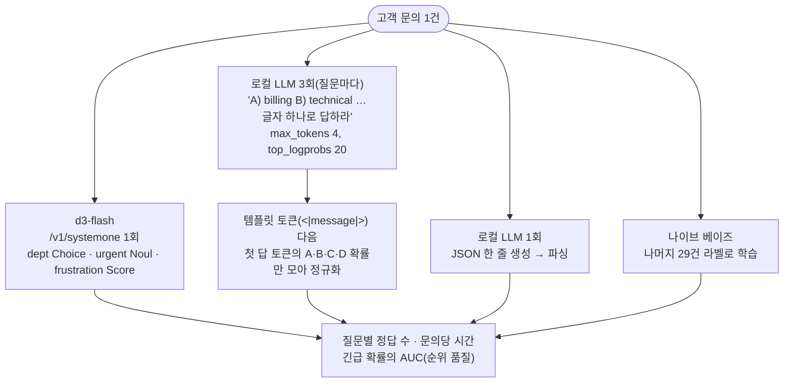

# local-judges

같은 판정(문의의 담당 팀, 긴급 여부, 불만도)을 네 가지 로컬 방법으로 내고 비교한다. 외부 API는 쓰지 않는다.

1. **d3-flash**: 판정 모델에 질문 3개(Choice·Noul·Score)를 한 요청으로 묻는다. Kev처럼 한 문맥에 여러 질문을 붙이는 방식이다.
2. **LLM 확률 직접 읽기**: 로컬 채팅 LLM에 질문마다 선택지를 A·B·C로 주고, 첫 답 토큰의 logprob에서 각 글자의 확률을 읽는다(SemIf/OpenJev 방식). 생성된 글을 파싱하지 않는다.
3. **LLM JSON 생성**: 같은 LLM이 세 답을 JSON 하나로 쓴다. 글에서 파싱하며 확률은 없다.
4. **소량 라벨 분류기**: 모델 없이 나머지 문의 29개의 라벨로 학습한 문자 bigram 나이브 베이즈다(한 개 빼고 학습). Kev의 "수백 개 예제로 도메인 적응"을 아주 작게 흉내 낸 기준선이다.

- 참고: [Kev](https://github.com/jaredpalmer/kev)(부서·긴급·불만을 한 요청에, 소량 데이터 파인튜닝), [SemIf](https://github.com/TheoLeeCJ/SemIf)(오픈 모델 로짓에서 후보 확률 직접 판독), [Jevlike](https://github.com/vinnylarouge/jevlike)
- 이슈: #23(Kev), #25(로컬 Jev형 모델 재현)

## 처리 흐름



- **LLM 확률 읽기는 템플릿 토큰을 건너뛴다.** 이 서버의 첫 출력 토큰은 `<|message|>`라서, 선택지 글자가 처음 나오는 위치의 top_logprobs를 읽는다.
- **확률이 있는 방법은 순위 품질(AUC)도 잰다.** 0.5 기준의 정답 수는 확률이 한쪽으로 치우치면 나빠지지만, 순위가 좋으면 기준값만 다시 정하면 된다(decision-calibration 샘플).
- LoRA 미세조정은 하지 않았다. 학습할 GPU 시간과 Kev 가중치가 이 환경에 없다. 소량 라벨 기준선은 "라벨 몇 개로 어디까지 가나"를 보여 주는 하한이다.

## 실행

레포 루트 `.env`의 `DECISION_*`, `LOCAL_LLM_*`를 쓴다.

```bash
uv sync
uv run pytest -q        # 오프라인, 5개
uv run python demo.py   # 문의 30건 × 방법 4개, 약 40초
```

## 측정 (d3-flash, muse-glimmer-30b, 2026-10-20)

`tickets.py`의 가상 문의 30건(팀별 6~8건, 긴급 7건, 불만도 0·1·2)이다.

| 방법 | 팀 | 긴급(0.5 기준) | 긴급 AUC | 불만도 | 문의당 |
|---|---|---|---|---|---|
| **d3-flash**(요청 1회) | **29/30** | 17/30 | **0.94** | 23/30 | 0.37초 |
| LLM 확률 읽기(요청 3회) | 25~26/30 | 9/30 | 0.76 | 24/30 | 0.37초 |
| LLM JSON 생성(요청 1회) | 23/30 | 20/30 | — | 24/30 | 0.51초 |
| 소량 라벨 나이브 베이즈 | 13/30 | 19/30 | 0.80 | 18/30 | 0.00초 |

(긴급: 매번 "아니다"라고 답하면 23/30)

- **팀 분류는 d3-flash가 가장 정확했다**(29/30). 같은 30B LLM은 확률을 읽으면 25~26, JSON으로 쓰게 하면 23이었다.
- **긴급은 0.5 기준으로는 모두 나빴다.** d3-flash는 긴급 7건 중 6건을 0.92 이상으로 매겼고 긴급하지 않은 문의는 모두 0.85 이하였다(AUC 0.94). 순위는 좋은데 확률이 전체적으로 높게 나왔다. 기준을 0.9로 두면 29/30이 된다. 다만 같은 30건으로 고른 값이라 보고 수치에는 넣지 않았다. LLM 확률 읽기는 거의 모든 문의를 "예"로 봐서 순위도 약했다(0.76).
- **불만도는 d3-flash와 두 LLM 방식이 비슷했다**(23~24/30).
- **속도**: LLM 확률 읽기는 질문 3개를 따로 물어도 문의당 0.37초로 d3-flash와 같았다(답 토큰 1~2개만 생성). JSON 생성은 0.51초였다. SemIf가 보고한 "JSON 생성이 직접 판독보다 5.21배 느림"만큼의 차이는 나지 않았다. 여기서는 생성할 JSON이 짧다.
- LLM 확률 읽기의 팀 정답 수는 실행마다 25와 26 사이에서 바뀌었다. 문의와 라벨은 직접 만든 30건이다.
