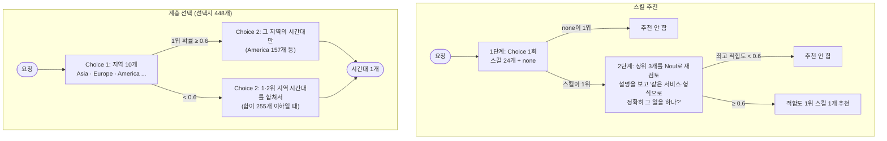

# many-options

선택지가 많을 때 판정 모델로 하나를 고르는 두 가지 방법이다.

1. **스킬 추천**: 스킬 24개 중 요청에 맞는 것을 최대 1개 추천하거나, 맞는 게 없으면 추천하지 않는다. 1단계에서 전체를 순위 매기고, 2단계에서 상위 3개를 설명과 함께 다시 검토한다.
2. **계층 선택**: 선택지가 255개를 넘으면 한 번에 물을 수 없다. 그룹을 먼저 고르고 그 안에서 고른다. 예제는 표준 라이브러리의 IANA 시간대 448개다.

- 참고: [TypeSafe cookbook: skill suggestion](https://docs.typesafe.ai/cookbooks/skill_suggestion), [tax-doc-classifier](https://github.com/kyotofin/tax-doc-classifier)(IRS 서식 261개를 계층으로 분류)
- 이슈: #2(스킬 추천), #14(255개 초과 계층 분류)

## 처리 흐름



- **d3-flash는 Choice 하나에 선택지를 255개까지만 받는다.** 256개부터 HTTP 422를 돌려준다. 255개짜리 질문은 응답에 약 2.2초가 걸렸고, 50개짜리는 약 0.4초였다. 그래서 255개 이하여도 그룹으로 나누면 빠르다.
- **그룹이 불확실하면 2위 그룹도 같이 본다.** 경계에 있는 요청에서 그룹 하나만 골라 틀리는 것을 줄인다. 합친 선택지가 255개를 넘으면 1위 그룹만 쓴다.
- **추천은 실행 허가가 아니다.** 스킬을 고르는 것까지만 하고, 실제로 쓸지는 에이전트가 정한다.

## 실행

레포 루트 `.env`의 `DECISION_*`를 쓴다. LLM은 쓰지 않는다.

```bash
uv sync
uv run pytest -q                 # 오프라인, 6개
uv run python demo.py            # 스킬 40건 + 시간대 40건, 약 45초
uv run python demo.py --zones-only
```

## 측정 (d3-flash, 2026-10-20)

### 스킬 추천

`skills.py`의 가상 스킬 24개(6분야)와 요청 40개(스킬이 맞는 요청 28개, 추천하지 말아야 할 요청 12개)다. 추천하지 말아야 할 요청에는 비슷하지만 틀린 경우를 섞었다. 마스토돈 게시(X 스킬만 있음), 디스코드 공지(Slack 스킬만 있음), AWS Lambda 배포(Docker 스킬만 있음), 노션·카카오톡 등이다.

| 방식 | 라벨 일치 | 틀린 추천 | 놓친 추천 |
|---|---|---|---|
| 1단계만 | 39/40 | 1 | 0 |
| 1단계 + 상위 3개 재검토 | 39/40 | 1 | 0 |

- 40건에 약 21초 걸렸다(1단계만 끝나는 요청은 1회, 나머지는 2회 호출).
- 이 세트에서는 재검토가 결과를 바꾸지 않았다. 1단계의 `none` 선택지가 이미 마스토돈·디스코드·Lambda 같은 비슷한 요청을 모두 걸렀다. cookbook은 Jev와 스킬 182개로 재검토가 필요했다. 스킬이 24개뿐이라 1단계로 충분했던 것으로 보인다.
- 틀린 1건은 "함수 이름 더 좋은 거 있을까?"에 refactor를 추천한 것이다(적합도 0.87). 라벨을 붙이며 "이름 제안은 스킬 없이 답한다"로 정했지만, refactor로 보는 것도 무리는 아니다.
- 처음에는 2단계에 "스킬이 필요한 요청인가"(needs_skill)도 물었다. d3-flash가 테스트·정규식 작성을 "말로 답할 수 있다"고 봐서 3건을 놓쳤다(36/40). 그 질문을 빼고 1단계의 `none`에 맡겼다.

### 계층 선택: 시간대 448개

`zoneinfo.available_timezones()`에서 지역 10개, 시간대 448개를 만들었다(`Etc/*`와 옛 별칭은 뺐다). 요청 40개는 "뭄바이 개발팀 스탠드업" → `Asia/Kolkata`처럼 도시 이름만 주고 시간대를 맞히게 했다.

| 항목 | 결과 |
|---|---|
| 한 번에 묻기(448개) | 불가: HTTP 422 |
| 지역 정답 | 39/40 |
| 시간대 정답 | **39/40** |
| 2위 지역까지 본 요청 | 2건 |
| 시간 | 40건에 약 22초(요청당 2회 호출) |

- 틀린 1건은 "라고스"를 태평양 지역으로 본 것이다. 지역 단계에서 틀리면 다음 단계에서 고칠 수 없다. 2위 지역(대서양)까지 같이 봤지만 아프리카는 들어가지 않았다.
- 요청과 라벨은 직접 만들었다. 시간대 라벨은 IANA 기준으로 하나로 정해지는 큰 도시만 골랐다.
