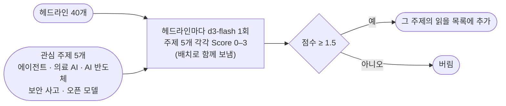

# news-match

아침 뉴스 헤드라인을 관심 주제 목록과 맞춰, 주제별로 읽을 기사를 골라 준다. 헤드라인마다 로컬 `d3-flash`에 한 번 묻고, 주제마다 Score(0~3, "이 관심을 가진 독자가 얼마나 읽고 싶어 할까")를 받는다. 점수가 기준 이상인 주제로만 보내므로, 한 기사가 여러 주제로 가거나 아무 데도 가지 않을 수 있다.

- 참고: [newsjack](https://newsjack.sh)(헤드라인 384건 × 브랜드 15개 매칭)
- 이슈: #16

## 처리 흐름



- **주제마다 따로 점수를 매긴다.** "랜섬웨어로 병원 진료 마비"는 보안 사고와 의료 AI 둘 다에 갈 수 있다.
- **낱말이 겹쳐도 내용이 다르면 0**이다. 점수 기준 0단계를 "낱말이 겹쳐도 그 관심과 무관"으로 적었다. "여행 에이전트", "감자칩", "보안 요원" 같은 헤드라인이 여기에 걸린다.

## 실행

레포 루트 `.env`의 `DECISION_*`를 쓴다. LLM은 쓰지 않는다.

```bash
uv sync
uv run pytest -q        # 오프라인, 3개
uv run python demo.py   # 40개 × 5개, 약 28초
```

## 측정 (d3-flash, 2026-10-20)

`feed.py`의 가상 헤드라인 40개다. 주제에 맞는 기사 20개(여러 주제에 걸치는 것 포함), 무관한 기사 10개, 주제 낱말이 들어간 무관한 기사 10개다. 맞춰야 할 (기사, 주제) 쌍은 27개다.

| 기준 | 고른 쌍 | 정밀도 | 재현율 |
|---|---|---|---|
| ≥ 1.0 | 28 | 0.89 | 0.93 |
| **≥ 1.5** | 25 | **1.00** | **0.93** |
| ≥ 2.0 | 22 | 1.00 | 0.81 |
| ≥ 2.5 | 1 | 1.00 | 0.04 |

- 헤드라인 40개 × 주제 5개(200쌍)에 약 28초 걸렸다(헤드라인 하나에 약 0.7초).
- 기준 1.5에서 놓친 2쌍: "랜섬웨어로 지역 병원 진료 마비"를 의료 AI로는 보내지 않았다(보안 사고로는 보냄). "오픈 모델로 만든 의료 영상 판독 에이전트"를 오픈 모델로는 보내지 않았다(의료 AI, 에이전트로는 보냄). 라벨을 붙일 때도 망설인 쌍이다.
- 낱말만 겹친 헤드라인 10개는 기준 1.5에서 하나도 고르지 않았다. 주식 시장 기사인 "반도체 업종 주가 하락"은 라벨대로 AI 반도체로 보냈다.
- 2.5 이상은 거의 나오지 않았다. 점수 기준의 최고 단계("가장 먼저 읽고 싶은 핵심 뉴스")가 엄격해서다. 기준값은 1.5~2.0 사이에서 고른다.
