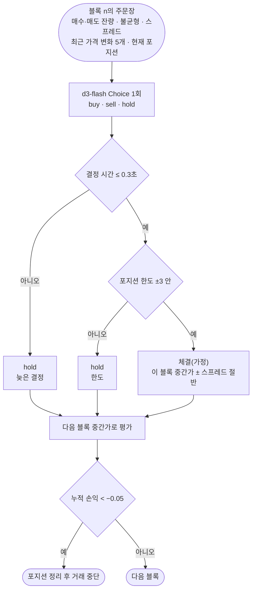

# order-sim

블록마다 매수·매도·보류를 정하는 판정을 **합성 주문장에서만** 돌려 본다. 거래소 연결, 지갑, 실제 주문은 없다. 실자금에 쓰지 않는다.

로컬 `d3-flash`는 방향만 고른다. 손실을 막는 일은 모두 코드가 한다: 결정 시간 초과 시 보류, 포지션 한도, 누적 손실 한도에서 포지션 정리 후 중단.

- 참고: [jev-trader](https://github.com/jarrodwatts/jev-trader)(블록마다 주문 방향 판단, 공개 배포는 dry-run)
- 이슈: #20

## 처리 흐름



- **합성 시장에는 일부러 신호를 넣었다.** 다음 가격 변화는 주문장 불균형을 따르고(`불균형 × 틱 + 잡음`), 스프레드는 틱의 10분의 1이다. 그래서 불균형을 읽으면 비용을 내고도 남고, 동전 던지기는 손해를 본다. 모델이 신호를 읽는지 보려는 장치일 뿐, 실제 시장과는 관계없다.
- **늦으면 보류한다.** jev-trader는 블록당 결정 창(약 0.3초)을 넘기면 주문을 내지 않는다. 이 샘플도 같은 규칙이다.

## 실행

레포 루트 `.env`의 `DECISION_*`를 쓴다. LLM은 쓰지 않는다.

```bash
uv sync
uv run pytest -q        # 오프라인, 7개
uv run python demo.py   # 200블록 × 정책 4개 + 50ms 예산 실험, 약 1분
```

## 측정 (d3-flash, 합성 200블록, seed 7, 2026-10-20)

| 정책 | 손익 | 거래 | 방향 적중 | 비고 |
|---|---|---|---|---|
| 항상 보류 | 0 | 0 | — | |
| 동전 던지기 | −0.057 | 23 | 52% | 40번째 블록에서 손실 한도 → 정리 후 중단 |
| 불균형 규칙(> 0.2면 매수, < −0.2면 매도) | +0.010 | 75 | 77% | 시장을 만든 방식을 아는 기준선 |
| **d3-flash** | **+0.024** | 155 | 70% | 보류 44, 포지션 한도에 막힘 25, 결정 p50 약 0.16초 |

- d3-flash는 불균형 신호를 읽었다(방향 적중 70%, 동전 던지기 52%). 규칙보다 자주 거래해서 손익이 더 컸다. 거래당 비용이 작게 설정된 합성 시장이라 가능한 결과다.
- 결정 예산을 50ms로 줄이면 199블록 모두 늦은 결정으로 보류됐다. 로컬 d3-flash의 결정 1회는 약 0.16초라 그보다 짧은 창에는 맞지 않는다.
- 손익 순위는 블록 수와 seed에 따라 바뀐다. 웹 기본값(100블록, seed 7)에서는 불균형 규칙이 적중 82%인데도 −0.034, d3-flash가 +0.046이었다. 거래 하나의 방향이 맞아도 들고 있는 포지션이 잡음에 따라 평가되기 때문이다. 방향 적중률이 손익보다 안정적인 지표다.
- 모든 숫자는 이 합성 시장에서만 의미가 있다. 실제 시장은 신호가 약하고, 비용·체결·지연이 이 모의와 전혀 다르다.
