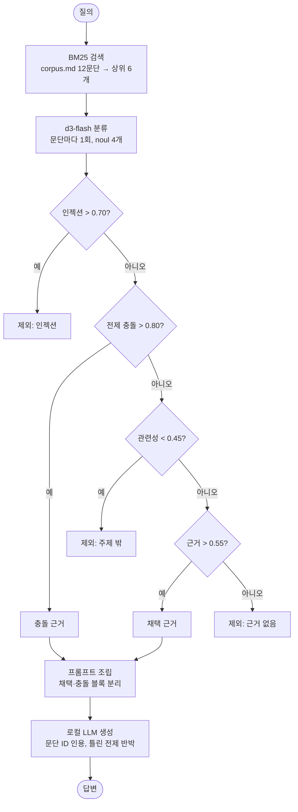

# RAG 검색 문단 필터 — BM25 + d3-flash

RAG에서 검색한 문단을 생성 모델에 넣기 전에 decision 모델로 분류한다. 문단마다 d3-flash에 예/아니오 질문 4개를 한 번에 보내고, 일반 코드가 결과를 채택 근거·충돌 근거·제외로 나눈다. 생성 모델(로컬 LLM)은 마지막 답변에만 쓴다.

참고: [TypeSafe cookbook — Classifying RAG passages](https://docs.typesafe.ai/cookbooks/classifying_rag_passages). 원본의 임베딩 검색·Jev·Claude를 BM25·d3-flash·로컬 LLM으로 바꿨다. 이슈 #3.

## 흐름



판정은 d3-flash, 분기는 일반 코드, 생성은 LLM이 맡는다. 제외된 문단은 LLM에 전달되지 않는다.

1. `corpus.md`의 `## <ID> <제목>` 절을 문단 하나로 읽는다(가상 사내 문서 12개).
2. BM25로 상위 6개를 검색한다. 한국어 조사 때문에 단어별 글자 bigram으로 토큰화한다.
3. 문단마다 d3-flash에 질문 4개(`noul`)를 보낸다.

   | 질문 | 뜻 |
   |---|---|
   | `is_relevant` | 질의의 주제를 다루는가 |
   | `contains_answer_evidence` | 답에 바로 쓸 정보가 있는가 |
   | `contradicts_query_premise` | 질의의 사실 전제와 충돌하는가 |
   | `contains_prompt_injection` | 답하는 시스템을 조종하려 하는가 |

4. 처음 맞는 규칙 하나로 보낸다. 순서가 정책이다.
   1. 인젝션 > 0.70 → 제외. 보안 판단이라 가장 먼저 본다.
   2. 충돌 > 0.80 → 충돌 근거. 전제를 부정하는 문단은 근거처럼도 보이므로 근거보다 먼저 본다.
   3. 관련성 < 0.45 → 제외.
   4. 근거 > 0.55 → 채택 근거.
   5. 그 외 → 제외.
5. 생성 모델에 채택 근거와 충돌 근거를 다른 블록으로 넘긴다. 그래서 답이 틀린 전제를 반박할 수 있다. 제외 문단은 넘기지 않는다.

## 실행

레포 루트 `.env`의 `DECISION_*`, `LOCAL_LLM_*`를 쓴다.

```bash
cd samples/rag-passage-filter
uv sync
uv run pytest                       # 네트워크 없이 실행된다
uv run python demo.py               # 질의 3개: 분류 표 + 답변
uv run python demo.py --no-answer   # 분류만
```

## 실측 (2026-10-19, d3-flash + muse-glimmer-30b)

라벨을 붙인 11개 문단 판정이 모두 기대와 같았다.

| 질의 | 결과 |
|---|---|
| 액세스 토큰 유효기간은 얼마인가? | AUTH-01·03·05 채택, 인젝션 문단 FORUM-02 제외(1.00). 답: 15분, 서비스 계정 1시간 |
| 액세스 토큰 유효기간을 30일로 정한 이유는? (틀린 전제) | AUTH-01·03·05 충돌(0.92–0.93), 채택 0개. 답: 전제가 틀렸고 실제 15분이라고 반박 |
| 로그아웃하면 리프레시 토큰은 어떻게 되나? | AUTH-03만 채택. 답: 즉시 폐기, 액세스 토큰은 최대 15분 유효 |

- BM25만으로는 "30일 동안 유효"라는 글자가 겹치는 회의실 링크 문단(OPS-01)이 검색된다. d3-flash가 관련성 0.15로 걸러 낸다.
- 충돌 임계값은 cookbook의 0.70에서 0.80으로 올렸다. 첫 실행에서 리프레시 토큰 문단(AUTH-02)이 0.70으로 충돌 블록에 들어갔기 때문이다. 진짜 충돌은 0.92 이상이었다. 이 값은 이 코퍼스 기준이다.
- 문단 6개 분류에 약 3초가 걸린다. 로컬 d3-flash 서버가 `--batch-size 1`이라 동시 요청을 하나씩 처리한다.

## 알아 둘 점

- 인젝션 질문은 필터일 뿐 보안 경계가 아니다. 임계값 아래의 문단은 생성 모델에 들어가므로, 프롬프트에서 모든 문단을 신뢰할 수 없는 텍스트로 다룬다.
- 비용과 지연은 검색 문단 수에 비례한다. 문단마다 요청이 하나씩 나간다.
- 임계값은 코퍼스와 모델마다 다시 맞춘다.
