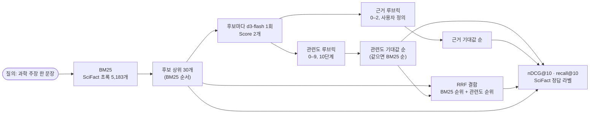

# rerank

BM25로 뽑은 후보 문서를 로컬 `d3-flash`의 `Score` 루브릭으로 다시 채점해 순서를 바꾼다. 공개 검색 벤치마크 SciFact(BEIR)의 정답으로 nDCG@10을 재서 BM25 그대로와 비교한다.

- 참고: [LambdaDB: native reranking with Jev](https://lambdadb.ai/blog/native-reranking-with-jev)(10단계 관련도 루브릭), [jev-search](https://github.com/superagents-lab/jev-search)(결과 관련도 채점)
- 이슈: #5(검색 리랭킹), #17(검색 결과 관련도 채점)

## 처리 흐름



- **Score 답은 기대값**이다. 레벨별 확률의 가중 평균이라 정렬에는 쓰기 좋지만 보정된 확률은 아니다. 점수가 같으면 BM25 순서를 유지한다.
- **루브릭 두 개를 한 요청에 묻는다.** 10단계 일반 관련도(LambdaDB 방식)와, SciFact 과제에 맞춘 3단계 근거 루브릭("이 초록이 주장을 지지하거나 반박하는 결과를 보고하는가")이다. 이슈의 "사용자 정의 기준 비교"에 해당한다.
- **RRF**(reciprocal rank fusion)는 각 순위 목록에서 `1/(60 + 순위)`를 더해 합친다. 점수의 척도를 맞출 필요가 없다.
- jev-search의 "검색 소스·기간 고르기"는 넣지 않았다. 고를 검색 API가 없는 로컬 코퍼스라서다.

## 실행

레포 루트 `.env`의 `DECISION_*`를 쓴다. LLM은 쓰지 않는다.

```bash
uv sync
uv run pytest -q          # 오프라인, 5개
uv run python demo.py     # 질의 30개 × 후보 30개 = 900요청, 약 7분
uv run python demo.py 5   # 질의 5개만
```

`data/scifact_30.json`에 질의 30개, 질의별 BM25 상위 30개 후보, 그 초록(앞 1,200자) 810개를 넣어 두었다. 전체 SciFact를 내려받아 `build_subset.py`로 다시 만들 수 있다. SciFact는 CC BY-NC 2.0이다(`data/README.md`).

## 측정 (d3-flash, 2026-10-20)

SciFact 테스트 질의 300개 중 무작위 30개(seed 0)다. 이 BM25 구현의 전체 300개 nDCG@10은 0.660으로, BEIR 논문의 BM25(0.665)와 거의 같다.

| 순서 | nDCG@10 |
|---|---|
| BM25 그대로 | 0.692 |
| 관련도 루브릭(10단계) | 0.698 |
| 근거 루브릭(3단계, 사용자 정의) | 0.681 |
| **BM25 + 관련도 RRF** | **0.708** |
| (참고) 정답을 아는 이상적 재정렬 | 0.820 |

- 요청 1건에 약 0.49초 걸렸다(초록 최대 1,200자, 질문 2개).
- 개선 폭은 작다. BM25가 이미 30개 질의 중 19개에서 정답을 1위에 두었고, 6개 정답 문서는 상위 30개 후보에 없어 재정렬로 끌어올릴 수 없다. 후보 안에서 가능한 최대치(0.820)까지 남은 차이 중 RRF가 약 12%를 줄였다.
- d3-flash 점수는 정답과 오답을 잘 갈랐다. 정답 문서의 관련도 평균은 5.47, 나머지는 1.35였다. 다만 정답의 27%만 7 이상을 받아, 정답을 최상위로 올릴 만큼 확신하지는 못했다. 질의별로는 6개가 좋아지고 4개가 나빠졌다.
- 3단계 근거 루브릭만 쓰면 BM25보다 나빴다. 단계가 거칠어 동점이 많고, 동점은 BM25 순서로 남는다. BM25와 RRF로 합치면 0.707로 올라간다.
- LambdaDB가 FiQA에서 보고한 Jev의 +14.7%와는 데이터·모델이 다르다. d3-flash를 이 영어 과학 초록 세트에 쓸 때는 단독 재정렬보다 BM25와 합치는 쪽이 낫다.
- 질의 30개는 작은 표본이다. 0.01 안팎의 차이는 다시 뽑으면 바뀔 수 있다.
