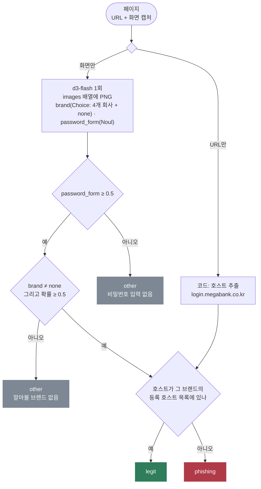

# screenshot-check

로그인 화면이 다른 회사를 사칭하는지 판정한다. 로컬 `d3-flash`는 화면 캡처만 보고 두 가지를 답한다. 어느 회사의 로고나 이름이 보이는지, 비밀번호를 입력받는지다. 그 회사의 공식 호스트인지는 코드가 URL로 확인한다. 같은 판정을 크롤러가 뽑은 텍스트로만 했을 때와 비교한다.

- 참고: [Cloudflare Clef](https://blog.cloudflare.com/clef-decision-models/)(렌더링 화면을 보는 도메인 분류), [Decision 3.0](https://decision.vllm-sr.ai/docs)(d3 멀티모달 가드레일)
- 이슈: #22(Clef 멀티모달 분류), #26(Decision 3.0 멀티모달 라우터·가드레일)

## 처리 흐름



- **모델은 URL을 보지 않는다.** 처음에는 주소창이 찍힌 캡처와 URL을 같이 보냈다. 그랬더니 "This domain is for sale" 페이지를 주소(cloudnest-login.net)만 보고 Cloudnest 로그인으로 판정했다. 화면만 보이고, 주소 판단은 등록 목록과 비교하는 코드에 맡겼다.
- **브랜드는 판정, 공식 여부는 사실 확인**이다. `kopay.com.login-check.top`처럼 공식 호스트를 앞에 붙인 주소도 정확히 같은 호스트가 아니면 공식이 아니다.
- **브랜드가 없는 로그인은 other**다. 사칭이 아니라 모르는 서비스의 로그인이다.

### 이미지 보내는 방법

로컬 `/v1/systemone` 서버는 요청 최상위의 `images` 배열(`data:image/png;base64,...`)에서 이미지를 읽는다. langchain-typesafe 0.0.1a3은 `state`와 `questions`만 보내므로, `ImageClassifier`가 `images`를 덧붙인다(비공개 메서드 `_payload`를 덮어쓴 임시 방편).

처음에는 LangChain 이미지 블록을 `state` 안에 넣었다. 그러면 base64 문자열이 그대로 텍스트로 들어가 요청 하나에 15~30초가 걸렸고, 답은 그림과 상관없이 거의 일정했다(비밀번호 입력 약 0.6, 브랜드 none). 이 측정 중에 d3-flash 컨테이너가 외부에서 재시작되기도 했다. `images` 배열로 바꾸니 요청 하나가 약 0.4초로 줄었다.

## 실행

레포 루트 `.env`의 `DECISION_*`를 쓴다. LLM은 쓰지 않는다.

```bash
uv sync
uv run pytest -q                # 오프라인, 11개
uv run python demo.py           # 16페이지를 화면으로 한 번, 텍스트로 한 번
uv run python render.py         # pages.py를 고친 뒤 shots/*.png 다시 만들기(google-chrome 필요)
```

## 측정 (d3-flash, 2026-10-20)

`pages.py`의 가상 페이지 16개다(정상 로그인 4, 사칭 8, 기타 4). 회사와 도메인은 모두 지어냈다. 사칭 8개 중 4개는 브랜드를 로고 그림(SVG)으로만 넣었다. 문자열 검사를 피하려는 피싱 키트가 쓰는 방식이다.

| 입력 | 라벨 일치 | 사칭 탐지 | 페이지당 |
|---|---|---|---|
| 화면 캡처(480×440 PNG) | **16/16** | **8/8** | 약 0.44초 |
| 추출한 텍스트만 | 11/16 | 4/8 | 약 0.24초 |

- 텍스트만으로는 로고로만 브랜드를 보인 사칭 4건을 모두 놓쳤다. 브랜드 이름이 텍스트에 없으니 "브랜드 없는 로그인"이 됐다. 같은 이유로 로고만 있는 정상 로그인(Cloudnest)도 other로 판정했다.
- 화면 캡처로는 로고에서 브랜드를 1.00에 가깝게 읽었다. 공지 글, 문서, 쿠폰, 판매 중 도메인 페이지는 비밀번호 입력을 0.00으로 봤다.
- 페이지는 직접 만든 깨끗한 화면이다. 실제 피싱 페이지는 로고를 비틀거나 흐리게 넣는 경우가 많아, 16/16은 이 세트에서의 결과다.
