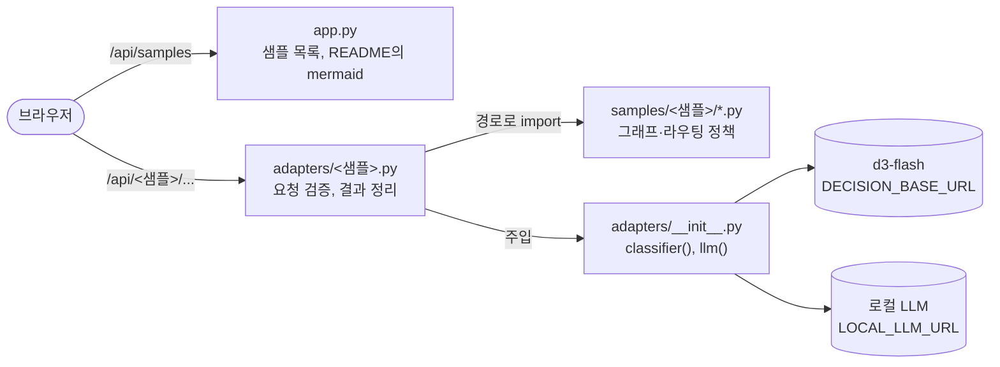

# 샘플 웹

`samples/`의 샘플을 브라우저에서 실행해 보는 화면이다. 샘플 코드를 고치지 않고 그대로 import해 실행하며, 판정 확률마다 분기 임계값을 막대 위 눈금으로 보여 준다.



- 모델 객체는 FastAPI 의존성(`classifier`, `llm`)으로 주입한다. 테스트는 스텁으로 바꿔 끼운다.
- discovery-review는 변호사 검토에서 그래프가 멈춘다. 실행마다 `thread_id`와 체크포인터를 서버 메모리에 두고(최근 50개), `/resume`으로 결정을 받아 이어 간다. 서버를 재시작하면 대기 중인 실행은 사라진다.
- 모델 서버에 연결하지 못하면 502와 함께 어느 모델이 실패했는지 알려 준다.
- mermaid 11.4.1(MIT)을 `static/vendor/`에 두어 인터넷 없이 다이어그램을 그린다.

## 실행

레포 루트 `.env`의 `DECISION_*`, `LOCAL_LLM_*`를 쓴다.

```bash
cd web
uv sync
uv run uvicorn app:app --port 8300   # http://127.0.0.1:8300
uv run pytest                        # 스텁 모델, 네트워크 없이 실행
```

## 샘플 추가

1. `adapters/<샘플>.py`에 `SUMMARY`와 `router`를 만든다. 샘플 모듈은 `load("<샘플>", "<모듈>")`로 가져온다.
2. `app.py`의 `ADAPTERS`와 `include_router`에 등록한다.
3. `static/views/<샘플>.js`에 화면 함수를 만들고 `static/app.js`의 `VIEWS`에 등록한다. 공용 도구(`h`, `api`, `meter` 등)는 `static/common.js`에 있다. 모델·사용자 문자열은 `h()`로 넣는다(`innerHTML` 금지).
4. 샘플이 새 의존성을 쓰면 `pyproject.toml`에도 추가한다.

## 디자인 정본

색·글꼴·간격 토큰은 `static/style.css`의 `:root` 한 곳에 둔다. 경로 색은 의미에만 쓴다: 초록은 제출·채택, 황색은 검토·충돌, 회색은 보류·제외, 빨강은 인젝션·오류다. 남색은 버튼과 "규칙에 걸린 값" 막대에 쓴다.
